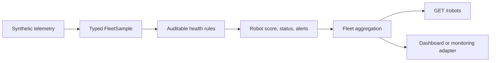

# Robot Fleet Observability

[](https://github.com/Parth-Oza/robot-fleet-observability/actions/workflows/test.yml)
[](https://www.python.org/)
[](LICENSE)

A dependency-free Python reference for converting robot telemetry into explainable health scores and serving the result through a small read-only JSON API. The project focuses on the operational questions behind a fleet dashboard: Which robots need attention, why, how severe is the issue, and what is the overall fleet condition?

> Every robot, metric, threshold, and timestamp is synthetic. This independent portfolio project contains no employer code, production endpoints, facility details, or operational data.

## Capabilities

- Validated, typed telemetry records for robot health snapshots.
- Explicit thresholds for battery, localization quality, CPU, and latency.
- Explainable per-robot scores, status, and alert codes.
- Fleet-level status counts, average health, and active-mission summary.
- Threaded, read-only HTTP service with stable JSON responses.
- Zero third-party runtime dependencies.



## Quick start

```bash
python -m venv .venv
source .venv/bin/activate
python -m pip install -e .
fleet-observability --port 8080
```

Query the service:

```bash
curl http://127.0.0.1:8080/health
curl http://127.0.0.1:8080/robots
```

Run the tests:

```bash
python -m unittest discover -s tests -v
```

## HTTP API

| Method | Path | Result |
|---|---|---|
| `GET` | `/health` | Service liveness document: `{"status": "ok"}` |
| `GET` | `/robots` | Fleet summary plus per-robot score, status, alerts, and original sample |
| `GET` | any other path | `404` JSON with the available endpoints |

The default bind address is `127.0.0.1:8080`. Use `--host` and `--port` to change it. The example has no authentication and should remain loopback-only unless it is placed behind an appropriate production gateway.

## Project layout

```text
src/robot_fleet_observability/health.py     Health model, rules, and aggregation
src/robot_fleet_observability/synthetic.py  Safe demonstration fleet
src/robot_fleet_observability/api.py        Threaded read-only JSON service
tests/test_health.py                        Scoring and aggregation tests
docs/ARCHITECTURE.md                        Design, contracts, and production path
```

## Engineering principles

- Keep every penalty and status transition auditable.
- Separate health evaluation from transport and data acquisition.
- Return deterministic, machine-readable output.
- Make demonstration data unmistakably synthetic.

See [Architecture](docs/ARCHITECTURE.md), [Contributing](CONTRIBUTING.md), and [Security](SECURITY.md).
