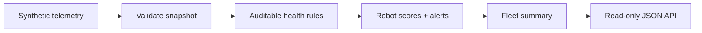

# Robot Fleet Observability

A dependency-free Python reference for converting robot telemetry into explainable fleet-health scores and serving the results through a tiny read-only API.

> Every robot, metric, threshold, and timestamp in this repository is synthetic. This is an independent portfolio demonstration with no employer code or operational data.

## Data path



The sample focuses on the production questions behind a dashboard: Which robots need attention? Why? How severe is the issue? What is the overall fleet condition?

## Quick start

```bash
python -m venv .venv
source .venv/bin/activate
python -m pip install -e .
fleet-observability --port 8080
```

Then open `http://127.0.0.1:8080/robots` or check `http://127.0.0.1:8080/health`.

Run the tests:

```bash
python -m unittest discover -s tests -v
```

## Engineering choices

- Explicit, testable thresholds instead of opaque health logic.
- A standard-library HTTP layer with zero runtime dependencies.
- Typed telemetry records and stable JSON responses.
- Clear separation between health evaluation and transport.
- Synthetic examples safe for public discussion and extension.
